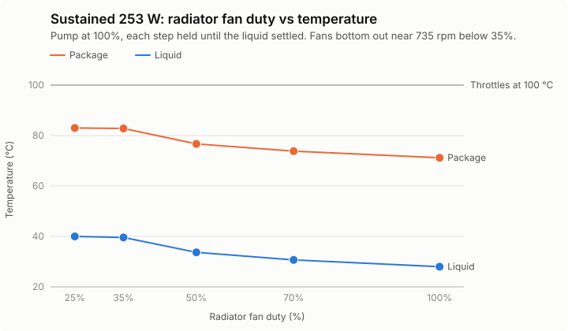
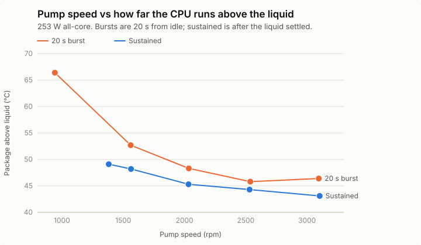
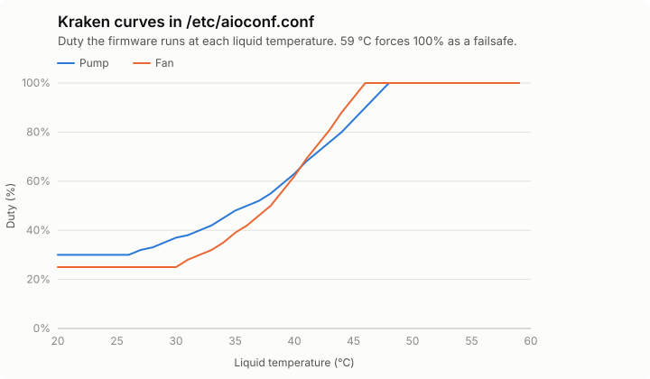
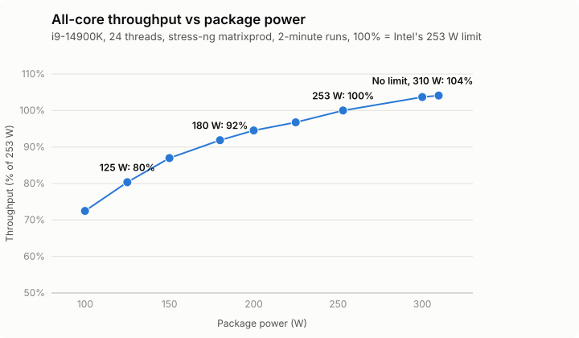
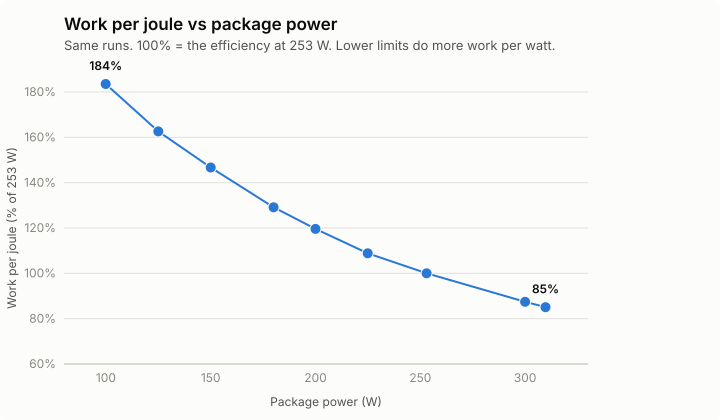
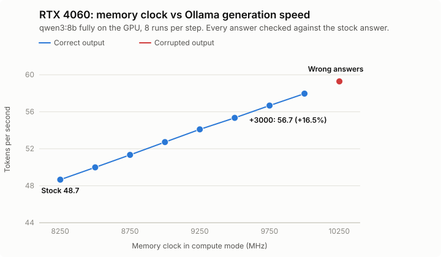
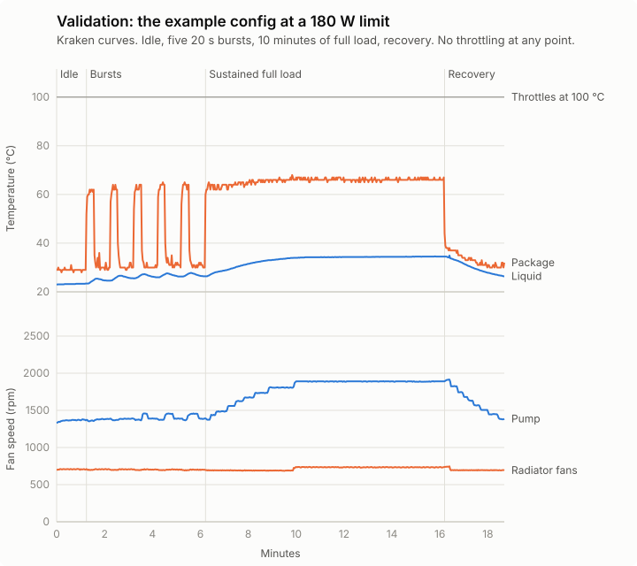

# aioconf

Fan curves for the **NZXT Kraken 2023** liquid cooler (USB `1e71:300e`, sold as
the Kraken and the Kraken Base) and for **motherboard fan headers** on Nuvoton
chips, plus an optional **NVIDIA memory clock offset**, on Linux. One config
file, applied at boot, with no daemon.

`aioconf` is a freestanding Rust binary. It has no libc and no dependencies,
not even `std`. It starts at its own `_start`, talks to the kernel through raw
`syscall` instructions, and exchanges 64-byte HID reports with the cooler
through `/dev/hidrawN`. The release build is a ~55 KB static executable with no
ELF interpreter.

It began as a port of a bash function that called
[liquidctl](https://github.com/liquidctl/liquidctl). The Kraken protocol and
curve math follow liquidctl's `kraken3` driver, and the generated curve tables
are byte-for-byte identical to liquidctl's.

```
$ aioconf
NZXT Kraken 2023 (/dev/hidraw4)
├── Liquid temperature    22.7  °C
├── Pump speed             942  rpm
├── Pump duty               20  %
├── Fan speed              684  rpm
└── Fan duty                20  %
```

Both the Kraken and the motherboard chip run fan curves in their own firmware.
`aioconf` only uploads the curves, so nothing keeps running afterwards. The
curves are lost when the Kraken loses power and when the BIOS reprograms the
motherboard chip at boot or resume, so a systemd service reapplies them.

## Install

```sh
cargo build --release
sudo make install
```

`make install` does the following:

- puts the binary in `/usr/local/bin`
- copies the example config to `/etc/aioconf.conf`, unless one exists
- adds a systemd service that applies the config at boot and after resume
- adds a udev rule that reapplies it when the Kraken is plugged in, and lets
  the logged-in desktop user run `aioconf` without `sudo`
- loads the `nct6775` motherboard fan driver now and at every boot (skip this
  with `make install BOARD=0`)
- adds `aioconf-nvidia`, a small Python helper the service runs for `gpu.*`
  lines. It does nothing without them.

`sudo make uninstall` removes everything except the config.

## Usage

```
aioconf [OPTIONS] [COMMAND]

  status                   Show liquid temperature, pump and fan speed (default)
  watch [SECONDS]          Show status every SECONDS (default 0.5) until Ctrl-C
  apply [FILE]             Apply the curves in FILE (default /etc/aioconf.conf),
                           for the Kraken and for motherboard fan headers
  set <pump|fan> <CURVE>   Set one channel. CURVE is a duty in %, or pairs of
                           liquid temperature in °C and duty in %
  full                     Run pump and fan at 100%
  board                    Show the motherboard fan headers and their curves
  init                     Initialize the device and show the firmware version
  list                     List the coolers found

  -d, --device <PATH>      Use this hidraw node instead of searching for one
  -n, --dry-run            Show what would be sent without opening the device
  -v, --verbose            Print every HID report sent and received
```

Try a curve without touching the device:

```
$ aioconf --dry-run set fan 30 25 36 60 40 100
would send 72 02 01 01 19 19 19 19 19 19 19 19 19 19 19 1f 25 2a 30 36 3c 46 50 5a 64 64 64 ...
fan   curve 30°C 25%, 36°C 60%, 40°C 100%  (command line)
      20-30°C 25%, 31°C 31%, 32°C 37%, 33°C 42%, 34°C 48%, 35°C 54%, 36°C 60%, 37°C 70%, ...
```

See what the motherboard chip is doing:

```
$ aioconf board
nct6798 (/sys/class/hwmon/hwmon9)
pwm2   64%   1363 rpm  curve (smart fan IV), following PECI Agent 0 Calibration (now 31°C): 20°C 60%, 45°C 70%, 60°C 85%, 70°C 100%
...
```

## Config

`/etc/aioconf.conf` holds every curve. Nothing is hard-coded in the binary.

```ini
# Kraken: pairs of liquid temperature in °C and duty in %, or one fixed duty
pump = 26 30  32 40  38 55  44 80  48 100
fan  = 30 25  34 35  38 50  42 75  46 100

# Motherboard header 1: up to 4 points, following a chip sensor
board.pwm1 = CPUTIN  40 40  50 50  60 70  68 100

# NVIDIA clock offsets in NVML's units, applied by aioconf-nvidia
gpu.mem_offset = 3000
```

- **Kraken curves** follow the cooler's own liquid temperature sensor. Duty is
  interpolated between points and held flat outside them. The firmware table
  covers 20 to 59 °C, and 59 °C forces 100% as a failsafe, as liquidctl does.
  The pump is never set below 20%.
- **Board curves** go into the chip's SmartFan IV mode. The sensor is a label
  from the chip, such as `SYSTIN` or `CPUTIN`, with spaces written as `_`, or
  `tempN`. `aioconf board` shows the labels in use. Below the first point the
  chip holds the first duty. The chip's fifth curve point, its critical
  temperature, is left as the BIOS set it. Ramp times are deliberately not
  configurable, see [Case fans](#case-fans).
- **GPU offsets** go through NVIDIA's NVML library, which the freestanding
  binary cannot load, so `aioconf` only validates them and `aioconf-nvidia`
  applies them. The memory clock that `nvidia-smi` reports rises by half the
  offset. `aioconf-nvidia status` shows the current offsets and allowed range.
- A line left out leaves that fan or clock alone.

After editing, run `sudo aioconf apply` or `sudo systemctl start aioconf`.

## Tuning

The example config was tuned with load tests on one machine:

| Part | Model |
|---|---|
| CPU | Intel Core i9-14900K, 8 P-cores and 16 E-cores, Hyper-Threading off |
| Cooler | NZXT Kraken 2023 with a 3-fan radiator, top exhaust |
| Case | NZXT H6 Flow, 3 front intake fans on motherboard header 1 |
| GPU | RTX 4060 |
| Room | about 22 °C |

The load was `stress-ng --cpu 24 --cpu-method matrixprod`, a heavy all-core
floating-point load. Temperatures come from hwmon, throttling from the
kernel's thermal throttle counters, power from RAPL. Throughput varied by
about 1% between identical runs. The data behind every chart is in
[`docs/data`](docs/data), `python3 docs/make_charts.py` redraws them, and the
scripts that ran the tests are in [`tools/loadtest`](tools/loadtest).

### Bursts and sustained load need different things

A 20-second all-core burst at 253 W never throttled on any setting tested. The
cooler's thermal mass absorbs it. What decides a burst is how far the CPU runs
above the liquid, and that depends on the **pump**.

Sustained load is decided by where the liquid settles, which depends on the
**radiator fans**. The CPU throttles at 100 °C. At 253 W and full pump speed
it runs about 43 °C above the liquid, so the liquid has to stay below about
55 °C. This radiator holds it far below that.

### Radiator fans



| Fan duty | Fan speed | Liquid | Package | Throttled | Throughput |
|---|---|---|---|---|---|
| 100% | 1752 rpm | 28.0 °C | 71 °C | 0% | reference |
| 70% | 1296 rpm | 30.7 °C | 74 °C | 0% | -0.7% |
| 50% | 1012 rpm | 33.7 °C | 77 °C | 0% | -0.6% |
| 35% | 739 rpm | 39.6 °C | 83 °C | 0% | -0.9% |
| 25% | 738 rpm | 40.0 °C | 83 °C | 0% | -1.4% |

Even at their minimum speed, the fans held sustained 253 W with the package at
83 °C. The small throughput loss at low speeds is not throttling. The CPU sits
at its power limit, hotter silicon leaks more of that power, and clocks drop
by about 1%. These fans run at a minimum of about 735 rpm below 35% duty.

The fan curve starts ramping at 34 °C liquid. Working from the table above,
sustained 253 W should settle the liquid near 36 °C in a 22 °C room and near
41 °C in a 32 °C room, both far from throttling. Those two figures are
estimates from this data, not separate measurements. Liquid above about 45 to 50 °C for long periods
wears the pump and tubing faster, so the curve reaches 100% at 46 °C.

### Pump



| Pump speed | Burst: package above liquid | Sustained: package above liquid |
|---|---|---|
| 942 to 1382 rpm, 20% | 66.4 °C | 49.1 °C |
| 1561 rpm, 35% | 52.7 °C | 48.2 °C |
| 2035 rpm, 50% | 48.3 °C | 45.3 °C |
| 2537 rpm, 70% | 45.8 °C | 44.3 °C |
| 3096 rpm, 100% | 46.4 °C | 43.1 °C |

Pump speed costs at most 6 °C under sustained load but 20 °C in a burst, and
nothing improves above about 50%. Idle liquid sits 1 to 2 °C above the room,
so a hot summer room means warm liquid before a burst even starts. The pump
curve therefore rises with liquid temperature: 30% when the liquid is cold,
40 to 55% around summer idle temperatures. That keeps about 15 °C of burst
headroom all year without running the pump fast at idle.

### Kraken curves



### Case fans

The three front intake fans feed the GPU and the radiator, which breathes case
air. They should rise with the radiator fans under sustained CPU load. The BIOS
default followed the CPU package temperature instead, which jumps from 28 to
78 °C within seconds of any burst, so the fans surged from 900 to 1250 rpm on
every burst.

The example config makes them follow `CPUTIN`, the socket and power-delivery
sensor. It climbs about 0.4 °C per second under load, so a burst only nudges
the fans while sustained load brings them up. These fans stop below about 30%
duty, so the floor is 40%.

| Front fan duty | 15% | 25% | 35% | 50% | 70% | 100% |
|---|---|---|---|---|---|---|
| Speed | 0 rpm | 0 rpm | 498 rpm | 743 rpm | 987 rpm | 1256 rpm |

The curve was checked on an unused header, programmed exactly as `aioconf`
does it, through 45 seconds of full load:

| Time | 0 s | 10 s | 20 s | 30 s | 45 s | 30 s after |
|---|---|---|---|---|---|---|
| CPUTIN | 35 °C | 41 °C | 48 °C | 52 °C | 54 °C | 39 °C |
| Duty | 40% | 41% | 48% | 54% | 58% | 40% |

**Don't write the chip's step times.** The `nct6775` driver also exposes
`pwmN_step_up_time` and `pwmN_step_down_time`, which set how fast a header
ramps. On this NCT6798D the BIOS leaves them at 0, the driver cannot write 0
back, and after any write to them the header stops following its curve until
the next reboot. `aioconf` never touches them.

### CPU power limit

The fans are not the only lever. The 14900K's last watts buy very little.





| Power limit | Throughput | Work per joule | P-core clock | E-core clock | Package |
|---|---|---|---|---|---|
| 100 W | 72.5% | 184% | 3601 MHz | 3105 MHz | 41 °C |
| 125 W | 80.3% | 163% | 4072 MHz | 3400 MHz | 45 °C |
| 150 W | 87.0% | 147% | 4380 MHz | 3653 MHz | 50 °C |
| 180 W | 91.9% | 129% | 4612 MHz | 3880 MHz | 56 °C |
| 200 W | 94.5% | 120% | 4815 MHz | 3937 MHz | 61 °C |
| 225 W | 96.8% | 109% | 5000 MHz | 4008 MHz | 66 °C |
| 253 W | 100% | 100% | 5193 MHz | 4101 MHz | 72 °C |
| 300 W | 103.7% | 87% | 5333 MHz | 4267 MHz | 83 °C |
| none, 310 W | 104.1% | 85% | 5381 MHz | 4283 MHz | 85 °C |

Throughput and work per joule are relative to 253 W, Intel's Maximum Turbo
Power, which this board applies as both its short and long power limit. With
no limit the chip stopped at 310 W on its own current limit, 4% faster for
22% more power.

A lower limit only slows heavy multi-core work. At 180 W, single-core turbo is
untouched:

| Busy cores at 180 W | P-core clock | E-core clock | Package power |
|---|---|---|---|
| 1 P-core, one of the two 6.0 GHz cores | 5844 MHz | | 70 W |
| 2 P-cores, both 6.0 GHz cores | 5754 MHz | | 94 W |
| 4 P-cores | 5674 MHz | | 130 W |
| 8 P-cores | 5387 MHz | | 180 W |
| 8 P-cores and 8 E-cores | 4999 MHz | 4042 MHz | 180 W |
| all 24 cores | 4612 MHz | 3885 MHz | 180 W |

The same single-thread runs without any limit averaged 5857 MHz on a 6.0 GHz
core, 5700 MHz on a 5.7 GHz core and 4400 MHz on an E-core. Up to four busy
P-cores run at full turbo under 180 W.

### GPU memory clock

Token generation in Ollama reads the whole model once per token, so on a
128-bit RTX 4060 it is limited by memory bandwidth. At stock, `qwen3:8b`
reached about 236 GB/s of the bus's 264 GB/s. Raising the memory clock raises
generation speed almost in proportion:



| Offset | Memory clock | Tokens/s | vs stock | Graphics clock | GPU peak | Answers |
|---|---|---|---|---|---|---|
| 0 | 8251 MHz | 48.66 | | 2700 MHz | 65 °C | correct |
| +1000 | 8751 MHz | 51.34 | +5.5% | 2655 MHz | 66 °C | correct |
| +2000 | 9251 MHz | 54.10 | +11.2% | 2625 MHz | 67 °C | correct |
| +3000 | 9751 MHz | 56.67 | +16.5% | 2610 MHz | 67 °C | correct |
| +3500 | 10001 MHz | 57.96 | +19.1% | 2565 MHz | 68 °C | correct |
| +4000 | 10251 MHz | 59.29 | +21.8% | 2535 MHz | 68 °C | **all wrong** |

Every run used temperature 0 and a fixed seed, so a working card returns the
same answer byte for byte. At +4000 nothing crashed and the kernel logged no
errors, yet all eight answers differed from the stock answer and from each
other. The memory was silently corrupting the model's numbers. **A memory
overclock has to be checked by its output, not by whether it crashes.**

Three things about the card shaped the choice:

- **One offset covers every power state.** Setting it for one state sets it
  for all.
- **Compute runs 250 MHz lower than graphics.** CUDA work such as Ollama runs
  in power state P2, games in P0. With `gpu.mem_offset = 3000`, Ollama gets
  9751 MHz and games get 10001 MHz.
- **The 115 W limit cannot be raised**, and the card reports no power reading
  on Linux. The memory overclock costs graphics clock instead, 2700 down to
  2610 MHz at +3000, which generation barely uses.

The chosen value is `gpu.mem_offset = 3000`. A 30-minute continuous run at
+3500 held compute at 10001 MHz, the clock games see at +3000. It returned 184
answers, every one identical to stock, with no driver errors and the GPU at
68 °C. At +3000, games run at that tested clock and compute runs 250 MHz below
it, 500 MHz below the first failure. Installed, Ollama generates 56.6 tokens
per second, 16.5% faster than stock.

The offset survives the GPU going idle but not a reboot or a driver reload,
so the service reapplies it at boot and after resume. To find your own value,
raise the offset in steps with a deterministic prompt and stop at the first
changed answer, then back off and run a long check. The scripts used here
compare every answer automatically.

### Hyper-Threading

All the runs above had Hyper-Threading off. Turned on afterwards, at the same
180 W limit:

| Load | 24 threads | 32 threads, using Hyper-Threading | Difference |
|---|---|---|---|
| `stress-ng --cpu-method int64` | 78,432 ops/s | 88,082 ops/s | +12.3% |
| `stress-ng --cpu-method matrixprod` | 55,438 ops/s | 53,051 ops/s | -4.3% |

Integer work gains, while heavy floating-point math loses a little when it
runs one thread per logical CPU, because two threads share one core's
floating-point units. With 24 busy threads it made no difference.

### Validation



The Kraken curves from the example config, at a 180 W power limit, from idle
through five bursts and 10 minutes of full load:

| Phase | Package | Liquid | Pump | Radiator fans | Throttled |
|---|---|---|---|---|---|
| Idle | 29 °C | 23.3 °C | 1371 rpm, 30% | 707 rpm, 25% | no |
| Five 20 s bursts | 62 to 65 °C peak | 23 to 27 °C | 1361 to 1386 rpm | 695 to 700 rpm | no |
| Last 3 minutes of full load | 66 °C | 34.5 °C | 1888 rpm, 45% | 734 rpm, 35% | no |

Sustained throughput was 55,167 ops/s, 1.0% below the 55,698 ops/s the same
limit gave with everything at full speed. That is within run-to-run noise. The
radiator fans never left their minimum speed, and the pump never passed 1900
rpm.

### Tuning your own

1. Run `aioconf watch` in one terminal and a load in another, such as
   `stress-ng --cpu $(nproc) --timeout 10m`.
2. Hold one setting until the liquid temperature stops moving, which takes 4
   to 6 minutes, then note the liquid and CPU temperatures.
3. Raise the fan curve where the liquid settles too high, and raise the pump
   floor if short bursts run the CPU close to its limit.
4. Check the throttle counters in
   `/sys/devices/system/cpu/cpu*/thermal_throttle/` stay flat.

## How it works

### Kraken

| Direction | Report | Meaning |
|---|---|---|
| to device | `72 01 01 00` + 40 bytes | pump duty table, one byte per °C from 20 to 59 |
| to device | `72 02 01 01` + 40 bytes | fan duty table |
| to device | `74 01` | request status |
| from device | `75 01 ...` | status: liquid °C at bytes 15-16, pump rpm 17-18, pump duty 19, fan rpm 23-24, fan duty 25 |
| to device | `70 02 01 b8 01`, `70 01` | initialize, with a 0.5 s status interval |
| to device | `10 01` | request firmware version, answered by `11 01 ...` |

The cooler is found by reading `/sys/class/hidraw/*/device/uevent`. The node is
then checked with the `HIDIOCGRAWINFO` ioctl before anything is written. The
Linux `nzxt_kraken3` hwmon driver can stay loaded. It initializes the device
when it binds and exposes readings through hwmon.

### Motherboard

`board.pwm*` lines are written to the `nct6775` driver's sysfs files: the
temperature source, four curve points, and then SmartFan IV
mode. The chip then runs the curve by itself. `aioconf` uses the driver rather
than the chip's I/O ports, because the driver and the ASUS firmware both access
the chip and direct port I/O would race them.

### Freestanding pieces

| File | What it replaces |
|---|---|
| `src/rt.rs` | the C runtime: `_start` in assembly, argv parsing, panic handler, `memcpy`, `memset`, `memmove`, `memcmp`, `strlen` |
| `src/sys.rs` | libc's syscall wrappers: `openat`, `read`, `write`, `close`, `ioctl`, `ppoll`, `getdents64`, `nanosleep`, `exit_group` |
| `src/io.rs` | buffered stdout and stderr, NUL-terminated paths, directory listing, file and sysfs reads and writes |
| `build.rs` | links with `-nostartfiles -nostdlib -static -no-pie` |

The protocol, curve math and config parser live in a `no_std`,
allocation-free library that is unit-tested on the host with `cargo test`.

Supported targets are x86_64 and aarch64 Linux. Only x86_64 has been tested on
hardware.

## Other hardware

Only the Kraken 2023 (`1e71:300e`) is supported and tested. liquidctl uses the
same speed protocol for the Kraken 2023 Elite and the Kraken 2024 Elite RGB and
Plus, so adding them is likely a small change in `src/proto.rs`. Board support
should work with any chip the `nct6775` driver handles in SmartFan IV mode, but
it has only been tested on an NCT6798D. Reports from owners are welcome.

## License

GPL-3.0-or-later, the same as liquidctl, whose `kraken3` driver documents the
protocol used here. Thanks to Tom Frey, Jonas Malaco, Shady Nawara and the
other liquidctl contributors who reverse-engineered it.
